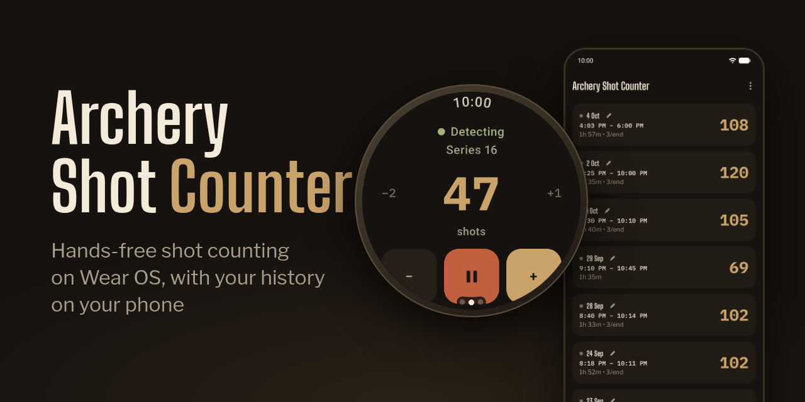
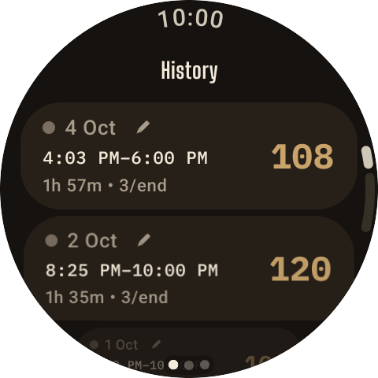
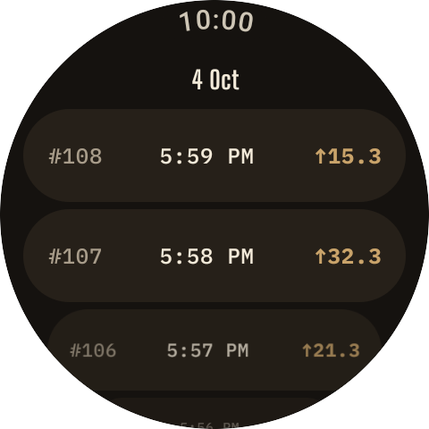

# Archery Shot Counter



A Wear OS app for archers that automatically counts shots using the wrist accelerometer — no buttons needed during shooting. Works with any bow style (compound, Olympic recurve, barebow, traditional) and on either wrist — just tune the sensitivity to match your setup.

Part of the [Archery Shot Counter](https://github.com/Vemestael/ArcheryShotCounter) project. Pair it with the [phone companion](https://github.com/Vemestael/ArcheryShotCounter-android) to browse, edit and back up your history from your phone.

## Screenshots

   

## Features

- **Automatic shot detection** — detects the recoil impulse of a bow release via the wrist accelerometer; the watch vibrates on every counted shot
- **Manual adjustment** — tap −/+ to correct the count if needed
- **Session tracking** — start, pause, resume and end training sessions
- **Ends (series)** — set shots per end; the counter shows your progress through the current end
- **Auto-pause** — optionally pauses detection for a set time after each end, so walking to the target isn't counted
- **Adjustable sensitivity** — High / Medium / Low presets or a custom threshold, plus a configurable cooldown between shots
- **Session history** — date, time range, duration and shot count for every session
- **Per-shot detail** — the timestamp and impact strength of every recorded shot
- **Session editing** — fix start/end time, shot count or shots per end right on the watch
- **Phone companion sync** — sessions sync to the [phone app](https://github.com/Vemestael/ArcheryShotCounter-android) live, and edits made on the phone show up on the watch
- **Energy efficiency** — keeps the screen on but dimmed while counting, and can hand over to the watch's Always On Display while paused
- **Six colour themes** (Brass, Forest, Target, Steel, Neon, Parchment) and three counter sizes
- **Backup via the phone** — sessions sync to the phone companion, which exports and imports them as JSON or CSV (see [Backing up your data](#backing-up-your-data) below)
- **12 interface languages** — English, Russian, Spanish, French, German, Portuguese, Chinese, Japanese, Korean, Arabic, Turkish and Hindi
- **No internet access** — no `INTERNET` permission, no accounts; your data stays on your devices

## Requirements

- Wear OS 3.0+ smartwatch (Android API 30+)
- Wrist-mounted accelerometer (standard on all WearOS watches)
- Tested on Galaxy Watch 6 Classic (bow arm, compound bow)

## Installation

Download the latest APK from the [Releases](https://github.com/Vemestael/ArcheryShotCounter-wearos/releases) page and sideload it to your watch via Wi-Fi ADB.

### 1. Prepare the watch

1. Make sure the watch and your PC are on the **same Wi-Fi network**.
2. On the watch, open **Settings → System → About** and tap **Build number** 7 times to enable Developer options.
3. Go to **Settings → Developer options** and enable:
   - **ADB debugging**
   - **Debug over Wi-Fi**
4. Open **Settings → Developer options → Debug over Wi-Fi → Pair device** — the watch will display an **IP address**, a **port**, and a **pairing code**.

### 2. Pair and connect from your PC

```bash
# Pair once using the code shown on the watch
adb pair <watch-ip>:<pairing-port> <pairing-code>

# Then connect
adb connect <watch-ip>:<port>
```

### 3. Install the APK

```bash
adb install ArcheryShotCounter-<version>.apk
```

## How it works

The app listens to `TYPE_LINEAR_ACCELERATION` (gravity-compensated) sensor data. When the string is released, the recoil creates a spike in wrist acceleration. If that spike exceeds the sensitivity threshold, a shot is counted, the watch vibrates briefly, and the sensor stops listening for the configured cooldown period before resuming.

The optimal sensitivity depends on your bow style and which wrist you wear the watch on — the bow arm typically produces a stronger impulse than the string arm. Use the Custom threshold if the presets don't work well for your setup.

## Backing up your data

The watch app has no export of its own. To keep a copy of your history, sync it to the [phone companion](https://github.com/Vemestael/ArcheryShotCounter-android) (Settings → Data → Sync data on the watch, or pull-to-refresh on the phone) and use Export there — JSON or CSV. Importing a backup on the phone and syncing brings the sessions back to the watch.

## Building from source

```bash
git clone https://github.com/Vemestael/ArcheryShotCounter-wearos.git
cd ArcheryShotCounter-wearos
./gradlew assembleDebug
```

For a signed release build, create `keystore.properties` in the project root (not committed):

```properties
storeFile=/path/to/your.jks
storePassword=...
keyAlias=...
keyPassword=...
```

Then run:

```bash
./gradlew assembleRelease
```

## License

MIT — see [LICENSE](LICENSE).
